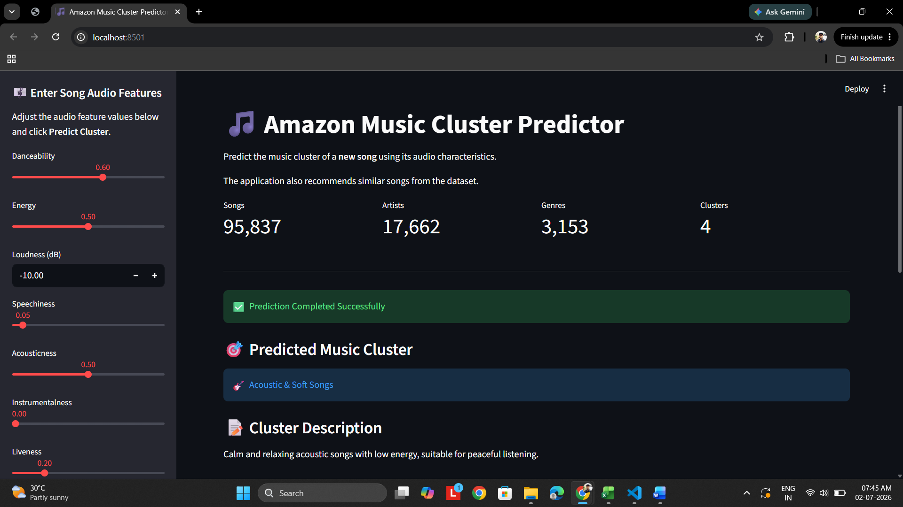

# 🎵 Amazon Music AI Recommender & Cluster Explorer

<p align="center">
  
</p>

<p align="center">

[](https://www.python.org/)
[](https://streamlit.io/)
[](https://scikit-learn.org/)
[](https://plotly.com/)
[](https://www.docker.com/)
[](https://opensource.org/licenses/MIT)

</p>

---

## 📖 Overview

The **Amazon Music AI Recommender & Cluster Explorer** is an end-to-end unsupervised machine learning and content-based recommendation platform. It analyzes **95,837 musical tracks** across **9 continuous audio characteristics**, grouping songs into **4 semantically distinct acoustic clusters** using **K-Means Clustering** with **StandardScaler normalization**.

The application pairs K-Means clustering with a **dual-metric recommendation engine** (Cosine Similarity & Euclidean Distance), interactive **Spotify Web Player embedding**, **Plotly audio radar charts**, and **2D PCA latent cluster projections**.

---

## ✨ Key Features & Enhancements

- 🎧 **Interactive Spotify Embeds**: Every song features embedded Spotify mini-players and direct listen links for instant audio discovery.
- 🔎 **95,000+ Track Library Search**: Search by song title or artist to auto-populate exact audio features and find similar songs.
- 🎛️ **Audio Synthesizer & Instant Presets**: Tune custom audio sliders (Danceability, Energy, Loudness, Tempo, Valence, Acousticness, etc.) or load 1-click vibe presets (*High-Energy Party, Acoustic Coffeehouse, Deep Ambient, Spoken Word, Melodic Pop*).
- 🧭 **Dual Similarity Engine**:
  - **Cosine Similarity (Recommended)**: Directional angular alignment of normalized audio vectors.
  - **Euclidean Distance**: Spatial geometric proximity in feature space.
- 🕸️ **Plotly Audio Radar (Spider) Chart**: Multi-layer radar chart comparing input song characteristics against cluster centroid averages.
- 🪐 **Interactive 2D PCA Cluster Map**: High-dimensional space reduced via Principal Component Analysis, plotting your active track with a golden star marker ⭐ in latent space.
- 📊 **Exploratory Data Analysis (EDA) Dashboard**: Donut distribution breakdown, cross-cluster feature comparison bar charts, and top track showcases per cluster.
- 🚀 **Cloud & Container Ready**: Self-contained relative path resolution, pinned `requirements.txt`, Docker configuration, and 1-click Streamlit Community Cloud support.

---

## 📂 Dataset & Audio Features

The model analyzes **95,837 tracks** across **9 core audio features**:

| Audio Feature | Description | Range / Unit |
| :--- | :--- | :--- |
| **Danceability** | How suitable a track is for dancing based on tempo, rhythm, and beat strength | $0.0 - 1.0$ |
| **Energy** | Perceptual measure of intensity, activity, dynamic range, and timbre | $0.0 - 1.0$ |
| **Loudness** | Overall loudness of a track in decibels (dB) | $-60.0 \text{ to } +5.4 \text{ dB}$ |
| **Speechiness** | Detects the presence of spoken words (audiobooks, podcasts vs songs) | $0.0 - 1.0$ |
| **Acousticness** | Confidence measure of whether the track is acoustic | $0.0 - 1.0$ |
| **Instrumentalness** | Predicts whether a track contains no vocals | $0.0 - 1.0$ |
| **Liveness** | Detects presence of an audience in the recording | $0.0 - 1.0$ |
| **Valence** | Musical positiveness (happy, euphoric vs sad, depressed) | $0.0 - 1.0$ |
| **Tempo** | Overall estimated pace of a track in beats per minute (BPM) | $0 - 240 \text{ BPM}$ |

---

## 📊 Optimal Cluster Selection ($K = 4$)

The optimal number of clusters was determined using the **Elbow Method (WCSS)**, **Silhouette Score**, and **Davies-Bouldin Index (DBI)**:

| $K$ | WCSS (Inertia) | Silhouette Score | Davies-Bouldin Index (DBI) | Selection Rationale |
| :---: | :---: | :---: | :---: | :--- |
| 2 | 685,950.97 | 0.2102 | 1.8692 | Under-segmentation |
| 3 | 573,286.79 | **0.2494** | 1.5169 | Highest silhouette, but merges instrumental & ambient with acoustic |
| **4** | **507,958.11** | **0.2394** | **1.4638** | **Selected Optimal: Lowest DBI, distinct separation of Instrumental vs Acoustic** |
| 5 | 464,185.95 | 0.1960 | 1.6164 | Overfitting / redundant splits |
| 6 | 437,304.11 | 0.1691 | 1.6251 | Degraded separation |

### 🎼 The 4 Acoustic Clusters

| Cluster # | Signature Name | Track Count | Core Audio Characteristics |
| :---: | :--- | :---: | :--- |
| **0** | **🎸 Acoustic & Melodic Music** | 29,173 (30.4%) | High acousticness ($0.70$), low energy ($0.34$), organic melodic vocals |
| **1** | **⚡ Energetic & Danceable Music** | 46,343 (48.4%) | High energy ($0.71$), high loudness ($-7.4\text{ dB}$), high valence ($0.69$), fast tempo |
| **2** | **🎙️ Speech & Narration Audio** | 12,474 (13.0%) | Dominant speechiness ($0.84$), podcasts, spoken word, comedy, radio plays |
| **3** | **🎹 Instrumental & Ambient Music** | 7,847 (8.2%) | Dominant instrumentalness ($0.81$), ambient soundscapes, focus & classical tracks |

---

## 🏗️ System Architecture

```
User Input (Search Track / Custom Sliders)
                   │
                   ▼
     Extract 9 Audio Features
                   │
                   ▼
 StandardScaler Transform: z = (x - μ) / σ
                   │
                   ▼
  K-Means Model (K = 4 Clusters)
                   │
                   ▼
     Predict Cluster Assignment
                   │
     ┌─────────────┴─────────────┐
     ▼                           ▼
Plotly Audio Radar        Similarity Engine
& PCA 2D Visualizer      (Cosine Sim / Euclidean)
                                 │
                                 ▼
                     Top-N Candidate Ranking
                                 │
                                 ▼
                    Interactive Spotify Players
                    & Downloadable CSV Playlist
```

---

## 🚀 Quickstart & Local Installation

### Prerequisites
- Python 3.10, 3.11, 3.12, or 3.13
- Git

### 1. Clone Repository
```bash
git clone https://github.com/gopinath-sara1n/amazon-music-clustering.git
cd amazon-music-clustering
```

### 2. Set Up Virtual Environment (Recommended)
```bash
# Windows
python -m venv venv
venv\Scripts\activate

# macOS / Linux
python3 -m venv venv
source venv/bin/activate
```

### 3. Install Dependencies
```bash
pip install -r requirements.txt
```

### 4. Launch Streamlit Application
```bash
streamlit run app.py
```
Open your browser at `http://localhost:8501`.

---

## 🌐 Cloud Deployment Guide

### Option 1: Streamlit Community Cloud (Recommended & Free)
1. Push your repository to GitHub (`https://github.com/gopinath-sara1n/amazon-music-clustering`).
2. Visit **[share.streamlit.io](https://share.streamlit.io/)** and sign in with GitHub.
3. Click **"New App"** and enter:
   - **Repository:** `gopinath-sara1n/amazon-music-clustering`
   - **Branch:** `main`
   - **Main file path:** `app.py`
4. Click **"Deploy"**!
> *The app automatically rebuilds on every `git push` to `main`.*

---

### Option 2: Docker Container (Hugging Face Spaces / Render / GCP / AWS)

Build and run using the included `Dockerfile`:

```bash
# 1. Build Docker image
docker build -t amazon-music-clustering .

# 2. Run container
docker run -d -p 8501:8501 --name music-app amazon-music-clustering
```
Access at `http://localhost:8501`.

---

## 📁 Repository Structure

```
amazon-music-clustering/
│
├── .streamlit/
│   └── config.toml             # Dark music-themed UI styling
├── images/
│   ├── streamlit_1.png         # Main app interface preview
│   ├── streamlit_2.png         # Recommendation view preview
│   ├── pca.png                 # PCA cluster separation
│   ├── heatmap.png             # Correlation heatmap
│   ├── feature_barplots.png    # Feature distributions
│   └── boxplot.png             # Feature box plots
│
├── app.py                      # Main production Streamlit web application
├── amazon_music_clustered.csv  # 95,837 Clustered tracks with Spotify IDs
├── kmeans_model.pkl            # Pre-trained K-Means (K=4) model
├── scaler.pkl                  # Fitted StandardScaler object
├── requirements.txt            # Production dependencies
├── Dockerfile                  # Containerized deployment manifest
├── .dockerignore               # Docker build exclusions
├── LICENSE                     # MIT Open Source License
└── README.md                   # Comprehensive project documentation
```

---

## 👨‍💻 Author

**Gopinath S**
- 🎓 **Background:** B.Tech Leather Technology | Data Science & Machine Learning
- 🐙 **GitHub:** [@gopinath-sara1n](https://github.com/gopinath-sara1n)
- 💼 **LinkedIn:** [Gopinath S](https://www.linkedin.com/in/gopinaths/)
- 📧 **Email:** *gopinath13107@gmail.com*

---

## 📜 License

This project is licensed under the **MIT License** — see the [LICENSE](LICENSE) file for details.
